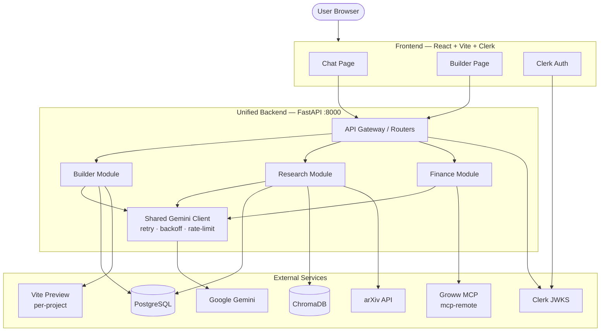
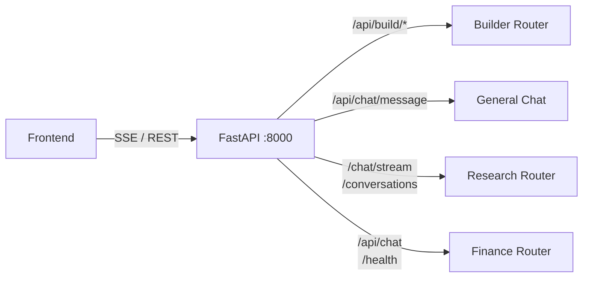
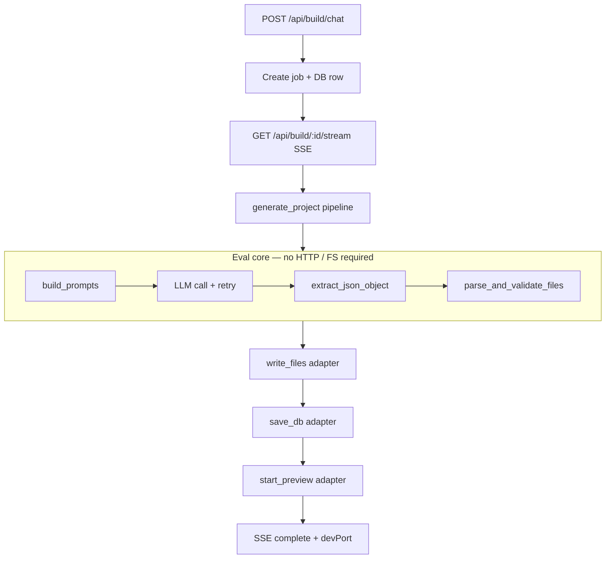
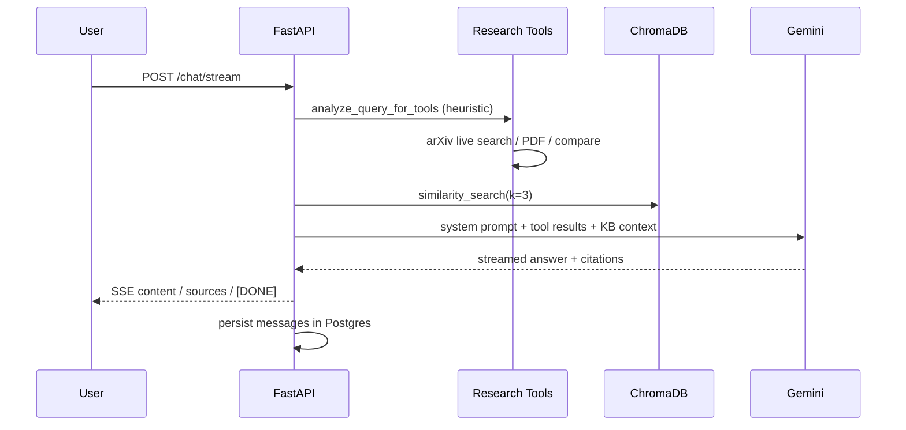
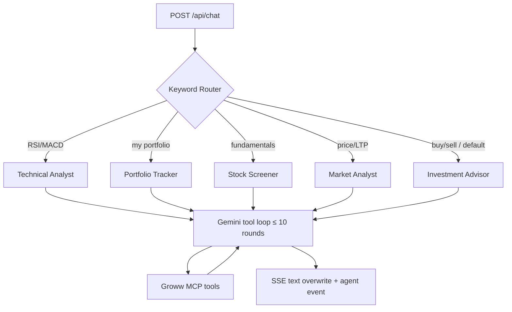
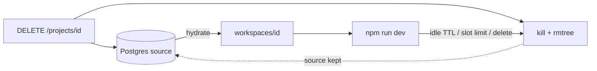
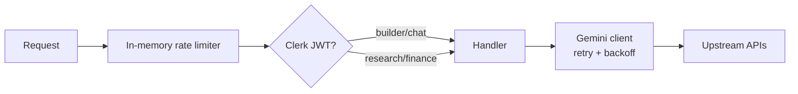
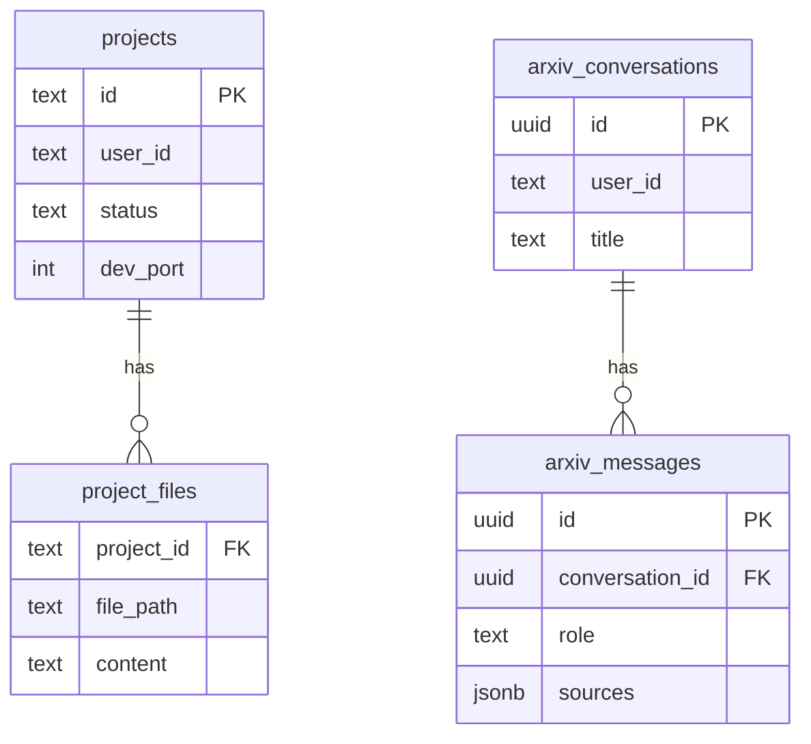

# Kiwi AI — High-Level Design (Interview Guide)

> One FastAPI backend serving three product modes: **Builder**, **Research**, and **Finance**.

---

## 1. System context (what exists)



---

## 2. Request routing (one port, three domains)

| Mode | Frontend base | Key endpoints |
|------|---------------|---------------|
| Builder + general chat | `http://localhost:8000` | `/api/build/*`, `/api/chat/message` |
| Research (arXiv RAG) | same | `/`, `/chat/stream`, `/conversations*` |
| Finance (Groww) | same | `/health`, `/api/chat`, `/api/tools` |



---

## 3. Builder pipeline (eval-friendly)

Core logic is **not** tied to Express/SSE. Stages are pure + injectable adapters:



**Interview talking point:**  
“I decoupled the agent/codegen loop into a pipeline with injected LLM, FS, DB, and preview adapters so I can run offline evals with a mocked LLM returning fixture JSON.”

---

## 4. Research RAG flow



---

## 5. Finance multi-agent tool loop



**Resilience:** exponential backoff on 429/5xx, `Retry-After` honor, tool-round delay, tool-output truncation, request dedup (429 if duplicate in-flight), allowlist fallback to all tools if names drift.

---

## 6b. Builder workspace budget (live Vite)



| Setting | Default | Effect |
|---------|---------|--------|
| `BUILDER_MAX_LIVE_PREVIEWS` | `1` | LRU-evict other live Vites before starting another |
| `BUILDER_IDLE_EVICT_SECONDS` | `900` | Stop Vite + wipe disk after idle (DB kept) |
| `BUILDER_IDLE_SWEEP_SECONDS` | `60` | Background sweep interval |

`DELETE /api/build/projects/{id}` removes Postgres rows **and** disk. `POST .../evict` frees disk only.

---

## 6. Cross-cutting concerns



| Concern | Where |
|---------|--------|
| Rate limit | `deps/rate_limit.py` — sliding window per IP/token |
| Auth | Clerk JWT (`require_auth` / `optional_auth` for SSE `?token=`) |
| Retry / backoff | `services/gemini_client.py` shared by builder + finance |
| Fallback | Builder empty-response retry; finance allowlist→all tools; MCP SSE noise ignored |

---

## 7. Data stores



ChromaDB holds arXiv chunk embeddings (`arxiv_papers` collection). Builder workspaces live on disk under `workspaces/`.

---

## 8. Repo layout (unified)

```text
backend/
├── app/
│   ├── main.py                 # lifespan, CORS, router mount
│   ├── config.py
│   ├── deps/                   # auth, rate_limit
│   ├── routers/                # builder | chat | research | finance
│   └── services/
│       ├── gemini_client.py    # shared retry client
│       ├── builder/            # pipeline (eval core) + jobs + db
│       ├── research/           # RAG agent, tools, chroma, pg
│       └── finance/            # agents, MCP, chat_loop
├── evals/                      # offline unit/eval tests
└── docs/HLD.md                 # this file
```

---

## 9. 60-second interview pitch

1. **Problem:** three Node/Python backends → ops friction, duplicated Gemini clients, three ports.  
2. **Solution:** one FastAPI process, domain routers, shared Gemini client with retries.  
3. **Builder:** codegen pipeline extracted for evals (mock LLM, assert JSON contract).  
4. **Research:** heuristic tools + Chroma RAG + mandatory arXiv citation URLs.  
5. **Finance:** keyword multi-agent router + MCP tool loop (max 10) with rate-limit resilience.  
6. **Frontend:** single `VITE_API_URL` (or hardcoded `:8000`) — path contracts unchanged.
